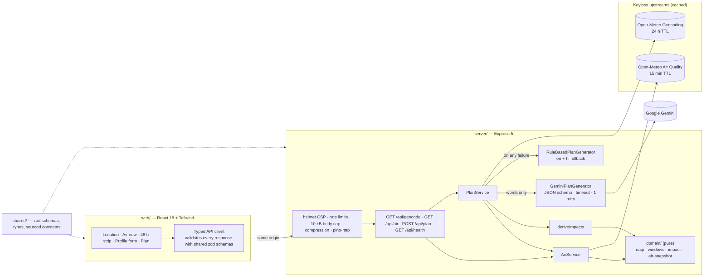

# Saans: breathe easier through smog season

- **Live demo:** https://virtualpromptwars6-saans.onrender.com
- **Demo video:** https://drive.google.com/file/d/1Fn2BU42fJjqi1mIyHg9ro3LRXmmWzDrN/view?usp=sharing
- **LinkedIn post:** https://lnkd.in/p/dRg9jEKK

Saans (साँस, "breath") is a GenAI assistant for families living through severe winter smog in Indian cities. Pick a location and describe your household. Saans then builds a plan for today:

- a **low-exposure routine** timed to the hourly air-quality forecast,
- **indoor air hacks**,
- **sustainable alternatives** for commuting, cooking, heating and waste,
- for each recommendation, **what it actually does**: PM2.5 you avoid breathing and CO₂ you avoid emitting, in numbers.

The whole interface is available in **English and Hindi**.

> All impact figures are estimates computed from published factors. NAQI values from hourly data are indicative; the official NAQI is a 24-hour average. Saans is not medical advice.

## Quality evidence

Each document maps one evaluation criterion to proof you can check: file links, test names and numbers measured with the commands it lists.

| Criterion         | Evidence                                     | Headline (measured 2026-11-19)                                                                    |
| ----------------- | -------------------------------------------- | ------------------------------------------------------------------------------------------------- |
| Problem alignment | [PROBLEM_ALIGNMENT.md](PROBLEM_ALIGNMENT.md) | 12 requirements traced to code and tests; a worked example from a live plan                       |
| Code quality      | [CODE_QUALITY.md](CODE_QUALITY.md)           | 0 lint warnings, 0 `any` / casts / `!`, 0 % duplication, 379 / 379 exports documented             |
| Testing           | [TESTING.md](TESTING.md)                     | 560 tests, 0 failures; 100 % line coverage in every package                                       |
| Security          | [SECURITY.md](SECURITY.md)                   | 12 threats → control → test; 0 audit vulnerabilities; actions SHA-pinned; CodeQL                  |
| Accessibility     | [ACCESSIBILITY.md](ACCESSIBILITY.md)         | WCAG 2.2 AA checklist; axe clean on 6 page states; Lighthouse accessibility 100                   |
| Efficiency        | [EFFICIENCY.md](EFFICIENCY.md)               | 3 TTL caches + stale-while-error; bounded retries; Lighthouse performance 99 mobile / 100 desktop |
| Architecture      | [docs/ARCHITECTURE.md](docs/ARCHITECTURE.md) | Layers, request flow, 8 recorded decisions                                                        |

## 1. Chosen vertical

**Urban Air Quality Assistant**: families in Indian cities living through severe winter smog.

- **The problem.** Every winter, still air and temperature inversions trap smoke from traffic, biomass and waste burning over north Indian cities. The NAQI regularly reaches Very poor or Severe. When Saans asked the forecast for Delhi at 19:00 IST on 2026-11-19, the NAQI was 312 (Very poor). The day's worst 2-hour window was 323, and the best was 95. Air quality changes hour by hour, and most families can't see that.
- **Who it is for.** Households planning a normal day: commuters, parents doing school runs, and people who exercise outdoors. It pays particular attention to **sensitive members**: children, older adults and anyone with heart or lung conditions. The profile asks only whether such members exist and never asks for a diagnosis.
- **Why it matters.** Most of a family's exposure comes from choices they control: when to go out, how to commute, whether windows are open at the peak, what they cook on and whether they run a purifier. Saans turns a forecast into those choices and shows what each one is worth.

## 2. Approach and logic

Every plan follows one deterministic decision flow, and the language model sits only at the end:

1. **Location + profile** → the hourly PM2.5/PM10 forecast for the next 48 h and the household's lifestyle (members, commute, office days, exercise, purifier, cooking fuel, language).
2. **NAQI** → each hour is scored with the CPCB National Air Quality Index ([method](#naqi-method)).
3. **Windows** → the cleanest and dirtiest 2-hour waking windows become the time-blocked routine.
4. **Impacts** → only the recommendations relevant to this household are kept, each with PM2.5 avoided and CO₂ saved computed from sourced factors ([formulas](#how-impact-is-calculated)).
5. **Gemini explains** → Gemini turns those facts into plain-language advice in English or Hindi. It never produces a number; if it fails, a rule-based generator writes the plan from the same facts.

**Key decisions and trade-offs**

| Decision                                            | Gain                                                     | Cost we accept                                              |
| --------------------------------------------------- | -------------------------------------------------------- | ----------------------------------------------------------- |
| Numbers in pure functions; Gemini only writes prose | Every figure is deterministic and unit-tested            | The model can't reason about numbers it wasn't given        |
| Rule-based fallback behind the same interface       | A plan is always returned, even with no key or an outage | Offline plans are less personal; the UI labels them as such |
| Forecasts cached per 2-dp cell (~1 km), 15 min      | Few upstream calls, fast repeat answers                  | Neighbours within a cell share one forecast                 |
| 109 bundled Indian cities searched first            | Instant, upstream-free search for common cities          | Smaller towns still need the geocoder                       |
| No accounts, nothing stored on disk                 | No personal data to leak                                 | No history across visits                                    |
| In-memory caches, one container                     | Simple to run and reason about                           | Caches reset on restart and aren't shared between instances |

## 3. How the solution works

1. Open the app and choose **Use my location** or search for a city.
2. Saans shows the **air now**: the NAQI, its category as text, icon and colour, the dominant pollutant and the CPCB health advisory.
3. A **48-hour strip** marks the best and worst windows to be outdoors.
4. Fill in the **household profile**: who lives there, how they commute and how far, office days, exercise habit, purifier and cooking fuel.
5. Submit to get **today's plan**: a time-blocked routine, indoor air hacks and sustainable alternatives.
6. Each recommendation shows **its impact** in numbers (µg of PM2.5 avoided and kg of CO₂ saved per week), labelled as an estimate.
7. Switch between **English and Hindi** at any time; the whole interface and the plan follow.

## 4. Assumptions

- NAQI values from hourly forecasts are **indicative**; the official CPCB NAQI is a 24-hour average.
- Inhalation rates of 0.5 / 1.0 / 2.5 m³/h for rest, light activity and moderate exercise (US EPA _Exposure Factors Handbook_).
- Protection factors of 0.6 indoors with windows closed, 0.25 with a HEPA purifier and 0.1 for a well-fitted N95 are **estimates** from published studies.
- Commutes run at **20 km/h** door to door, two trips per office day.
- CO₂ factors are TERI's Delhi per-passenger figures (public transport 2019-20); the **metro uses TERI's upper bound**, so metro savings are conservative.
- CPCB publishes no upper Severe breakpoint, so the Severe band is **interpolated up to PM2.5 380 / PM10 510** µg/m³ and capped at 500.
- Saans gives general guidance and is **not medical advice**.

### Known limitations

- The NAQI uses **PM2.5 and PM10 only**. CPCB's full index also covers other pollutants.
- The air data are **model forecasts** from Open-Meteo, not readings from CPCB ground stations.
- Doses use **adult** inhalation rates for every member of the household, children included.
- Gemini is told to use only the numbers it is given, and every figure on an impact card comes from our code. **Numbers inside Gemini's prose are not machine-checked.**
- Rate limits are per IP, so many users behind one shared network share a budget.
- The plan covers the **next 24 hours**. It has no weekly view or reminders.

---

## The brief, requirement by requirement

Routines, indoor hacks, alternatives, location and lifestyle tailoring, and direct impact are each traced to their implementation and tests in [PROBLEM_ALIGNMENT.md](PROBLEM_ALIGNMENT.md). That document also walks through one live Delhi plan, number by number.

## Architecture

Layers, the `POST /api/plan` request flow and the engineering decisions are in [docs/ARCHITECTURE.md](docs/ARCHITECTURE.md).



- **One source of truth.** `shared/` holds every API contract as a zod schema plus every numeric constant. The server validates input with it, and the browser validates responses with it.
- **The LLM never invents numbers.** `PlanService` computes the NAQI, the windows and every impact figure in `domain/`. Gemini receives those facts and writes explanations. Its JSON output is validated strictly, any unknown impact id is rejected, and impact **titles** always come from our own reviewed copy.
- **Always a plan.** If `GEMINI_API_KEY`/`GEMINI_MODEL` is unset, or Gemini times out, errors or returns invalid output, `RuleBasedPlanGenerator` builds the plan from the same facts. The response says which one ran (`source: "ai" | "fallback"`), and the UI shows "AI-personalised" or "Offline guidance".
- **Dependency injection throughout.** Providers, generators, the clock and `fetch` are interfaces injected at the composition roots (`server/src/compose.ts`, `web/src/main.tsx`). Tests swap in fakes, so no test touches the network.

---

## How impact is calculated

All constants live in [`shared/src/constants/`](shared/src/constants/), one module per domain (exposure, emissions, NAQI breakpoints, time, limits), each with a source comment. Results are rounded once, at the end (`server/src/domain/rounding.ts`).

```
dose (µg)   = PM2.5 (µg/m³) × inhalation rate (m³/h) × hours × protection factor
avoided     = max(0, dose_baseline − dose_alternative)      percent = avoided / dose_baseline
kg CO₂/week = one-way km × trips per week × max(0, factor_from − factor_to)
```

| Inhalation rate (adult) | m³/h | Protection factor (fraction inhaled) | Value | Basis                                                               |
| ----------------------- | ---- | ------------------------------------ | ----- | ------------------------------------------------------------------- |
| Rest / sedentary        | 0.5  | Outdoors, unprotected                | 1.0   | Definition (baseline)                                               |
| Light activity          | 1.0  | Indoors, windows closed              | 0.6   | Infiltration ~0.3–0.8 (Chen & Zhao 2011, _Atmos. Environ._)         |
| Moderate exercise       | 2.5  | Indoors + HEPA purifier              | 0.25  | Purifier field studies (Cheek et al. 2021 review)                   |
|                         |      | Well-fitted N95                      | 0.1   | ≥ 95 % filtration, allowing for fit leakage (Grinshpun et al. 2009) |

Inhalation rates: US EPA _Exposure Factors Handbook_ (2011), ch. 6.

| Mode (TERI, g CO₂ per passenger-km) | Car (weighted) | CNG auto | Two-wheeler | Bus   | Metro (upper bound) | Walk / cycle |
| ----------------------------------- | -------------- | -------- | ----------- | ----- | ------------------- | ------------ |
| Factor                              | 87.73          | 64.10    | 41.29       | 29.48 | 29.29               | 0            |

Source: [TERI, "Per passenger emission in Delhi – Different Modes"](https://teriin.org/sites/default/transport/Per_passenger_emission_in_Delhi_Different_Modes.pdf); public-transport figures are for 2019-20 (pre-COVID).

| Recommendation                               | Baseline → alternative                                    | Assumptions (labelled estimates)                                             |
| -------------------------------------------- | --------------------------------------------------------- | ---------------------------------------------------------------------------- |
| Take the metro (car, two-wheeler, auto, bus) | each mode's exposure profile → closed metro coach         | 20 km/h door-to-door, 2 trips per office day; profiles in `COMMUTE_EXPOSURE` |
| N95 on the commute (open-air modes)          | no protection → N95                                       | as above                                                                     |
| Exercise in the best window                  | worst-window PM2.5 → best-window PM2.5, moderate activity | the household's stated minutes                                               |
| Exercise indoors (every waking hour Severe)  | outdoors → closed room (HEPA if they own one)             | 24 h mean PM2.5                                                              |
| Close windows at the peak                    | windows open → closed, at rest                            | worst window's length and mean PM2.5                                         |
| Run or get a HEPA purifier                   | closed room → closed room + HEPA                          | 8 h of sleep, 24 h mean PM2.5                                                |

Exposure figures are **per person**: per office day for commute items, per day for the rest. Each also carries a relatable comparison, computed by us (never by Gemini): `restHoursEquivalent = avoided dose ÷ current PM2.5 ÷ 0.5 m³/h`, shown as "≈ the same as N hours of breathing today’s outdoor air at rest".

---

## NAQI method

Saans implements the CPCB National Air Quality Index (2014) for PM2.5 and PM10 (`server/src/domain/naqi.ts`). The sub-index is linearly interpolated within each band, and the overall NAQI is the larger sub-index. Every breakpoint is unit-tested at its low end, its high end and high + 0.1.

| Category     | Index   | PM2.5 (µg/m³) | PM10 (µg/m³) |
| ------------ | ------- | ------------- | ------------ |
| Good         | 0–50    | 0–30          | 0–50         |
| Satisfactory | 51–100  | 31–60         | 51–100       |
| Moderate     | 101–200 | 61–90         | 101–250      |
| Poor         | 201–300 | 91–120        | 251–350      |
| Very poor    | 301–400 | 121–250       | 351–430      |
| Severe       | 401–500 | > 250         | > 430        |

- **Severe-band assumption.** CPCB publishes no upper breakpoint for Severe. Saans interpolates 401→500 over PM2.5 250→380 and PM10 430→510, then caps at 500 (`SEVERE_ASSUMED_UPPER_CONCENTRATION`).
- **Integer gaps.** Concentrations between integer breakpoints, such as PM2.5 30.5, take the lower edge of the next band.
- **Windows** are contiguous, never span missing hours, must fit 06:00–22:00, and tie-break to the earliest. If every waking hour is Severe, the least-bad window is still shown and flagged `allUnsafe`.

---

## Security, efficiency, accessibility, testing

- **Security.** The app sets a strict CSP and grants no CORS. It has per-IP rate limits, a 10 kB body cap, zod on every input, a fenced prompt for user text, a server-only key and one error shape. Threat → control → test: [SECURITY.md](SECURITY.md).
- **Efficiency.** Three TTL caches, stale-while-error forecasts, bounded retries with jitter, an 8 s / 20 s Gemini budget, compression, and lazy-loaded zod and results. Measured sizes and Lighthouse: [EFFICIENCY.md](EFFICIENCY.md).
- **Accessibility.** WCAG 2.2 AA: category as text + icon + colour, a skip link, a keyboard combobox, `aria-live` results, 24 px targets, and `lang` that follows en/hi. Checklist and tests: [ACCESSIBILITY.md](ACCESSIBILITY.md).
- **Testing.** `npm run check` runs typecheck, lint (0 warnings), format, duplication and tests with coverage. No test touches the network. Pyramid, coverage and edge cases: [TESTING.md](TESTING.md).

## Local setup

Requires **Node 22** (`.nvmrc`). Node 20 reached end of life in April 2026.

```bash
npm ci
cp .env.example .env        # optionally add GEMINI_API_KEY and GEMINI_MODEL
npm run dev:server          # API on http://localhost:8080
npm run dev:web             # UI on http://localhost:5173 (proxies /api)
npm run check               # everything CI checks before the build
```

Production build: `npm run build && npm start` serves the built UI and the API from one process. Gemini setup check: `npm run gemini:check` lists the models your `GEMINI_API_KEY` can call and says whether `GEMINI_MODEL` is among them. It reads `.env` and never prints the key.

### Environment variables

| Variable                | Default       | Purpose                                                                                                      |
| ----------------------- | ------------- | ------------------------------------------------------------------------------------------------------------ |
| `PORT`                  | `8080`        | HTTP port (Render injects it)                                                                                |
| `HOST`                  | `0.0.0.0`     | Interface to bind                                                                                            |
| `NODE_ENV`              | `development` | `development` / `production` / `test`                                                                        |
| `LOG_LEVEL`             | `info`        | pino level                                                                                                   |
| `WEB_DIST_DIR`          | `web/dist`    | Built UI directory                                                                                           |
| `GEMINI_API_KEY`        | —             | Google AI Studio key, server-side only. If unset, offline plans only.                                        |
| `GEMINI_MODEL`          | —             | Gemini model id. If neither this nor `GEMINI_MODELS` is set, offline plans only.                             |
| `GEMINI_MODELS`         | —             | Optional comma-separated model ids, tried in order once each within a 20 s budget; wins over `GEMINI_MODEL`. |
| `GEMINI_THINKING_LEVEL` | —             | Optional `low`/`medium`/`high` for models that think by default (cuts latency). Unset sends nothing.         |

## Deployment

1. **Container.** One multi-stage `Dockerfile` builds the web app and the server, then ships the compiled output with production dependencies to a non-root runtime image. It declares a `HEALTHCHECK` on `/api/health`.
2. **Render.** Create a Web Service from this repo with the Docker runtime. Set `GEMINI_API_KEY` and `GEMINI_MODEL` as secret environment variables, and set the health-check path to `/api/health`.
3. **Keep-alive.** A cron-job.org job pings `/api/health` every 10 minutes so the free instance doesn't sleep. The route is never rate-limited.
4. **CI.** GitHub Actions runs install → typecheck → lint → format → duplication → tests with coverage → dependency audit → build, then builds the Docker image and probes `/api/health` from a running container. CodeQL runs on every push and weekly.

## Repository layout

```
shared/   zod schemas (profile, air, plan, errors), sourced constants, local-time and NAQI text helpers
server/   domain/ (pure) · providers/ · plan/ · services/ · routes/ · middleware/ · lib/
web/      api/ · hooks/ · i18n/ (en, hi) · components/ · naqi/
docs/     ARCHITECTURE.md (layers, request flow, engineering decisions)
scripts/  check-gemini.mjs (npm run gemini:check)
*.md      evidence: PROBLEM_ALIGNMENT, CODE_QUALITY, TESTING, SECURITY, ACCESSIBILITY, EFFICIENCY
```

## License and security

MIT, see [LICENSE](LICENSE). To report a vulnerability, see [SECURITY.md](SECURITY.md#reporting-a-vulnerability).
