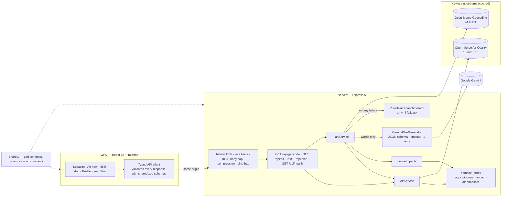

# Saans: breathe easier through smog season

- **Live demo:** https://virtualpromptwars6-saans.onrender.com
- **Demo video:** <VIDEO_LINK>
- **LinkedIn post:** <LINKEDIN_LINK>

Saans (साँस, "breath") is a GenAI assistant for families living through severe winter smog in Indian cities. Pick a location and describe your household. Saans then builds a plan for today:

- a **low-exposure routine** timed to the hourly air-quality forecast,
- **indoor air hacks**,
- **sustainable alternatives** for commuting, cooking, heating and waste,
- for each recommendation, **what it actually does**: PM2.5 you avoid breathing and CO₂ you avoid emitting, in numbers.

The whole interface is available in **English and Hindi**.

> All impact figures are estimates computed from published factors. NAQI values from hourly data are indicative; the official NAQI is a 24-hour average. Saans is not medical advice.

## Chosen vertical

**Urban Air Quality Assistant**: families in Indian cities living through severe winter smog.

## Approach and logic

Every plan follows one deterministic decision flow, and the language model sits only at the end:

1. **Location + profile** → the hourly PM2.5/PM10 forecast for the next 48 h and the household's lifestyle (members, commute, office days, exercise, purifier, cooking fuel, language).
2. **NAQI** → each hour is scored with the CPCB National Air Quality Index ([method](#naqi-method)).
3. **Windows** → the cleanest and dirtiest 2-hour waking windows become the time-blocked routine.
4. **Impacts** → only the recommendations relevant to this household are kept, each with PM2.5 avoided and CO₂ saved computed from sourced factors ([formulas](#how-impact-is-calculated)).
5. **Gemini explains** → Gemini turns those facts into plain-language advice in English or Hindi. It never produces a number; if it fails, a rule-based generator writes the plan from the same facts ([architecture](#architecture)).

## How the solution works

1. Open the app and choose **Use my location** or search for a city.
2. Saans shows the **air now**: the NAQI, its category as text, icon and colour, the dominant pollutant and the CPCB health advisory.
3. A **48-hour strip** marks the best and worst windows to be outdoors.
4. Fill in the **household profile**: who lives there, how they commute and how far, office days, exercise habit, purifier and cooking fuel.
5. Submit to get **today's plan**: a time-blocked routine, indoor air hacks and sustainable alternatives.
6. Each recommendation shows **its impact** in numbers (µg of PM2.5 avoided and kg of CO₂ saved per week), labelled as an estimate.
7. Switch between **English and Hindi** at any time; the whole interface and the plan follow.

## Assumptions

- NAQI values from hourly forecasts are **indicative**; the official CPCB NAQI is a 24-hour average.
- Inhalation rates of 0.5 / 1.0 / 2.5 m³/h for rest, light activity and moderate exercise (US EPA _Exposure Factors Handbook_).
- Protection factors of 0.6 indoors with windows closed, 0.25 with a HEPA purifier and 0.1 for a well-fitted N95 are **estimates** from published studies.
- Commutes run at **20 km/h** door to door, two trips per office day.
- CO₂ factors are TERI's Delhi per-passenger figures (public transport 2019-20); the **metro uses TERI's upper bound**, so metro savings are conservative.
- CPCB publishes no upper Severe breakpoint, so the Severe band is **interpolated up to PM2.5 380 / PM10 510** µg/m³ and capped at 500.
- Saans gives general guidance and is **not medical advice**.

Details and sources: [How impact is calculated](#how-impact-is-calculated) · [NAQI method](#naqi-method).

---

## The problem, and how each part of the brief is met

| Brief                                      | How Saans does it                                                                                                                                                                                                                        | Where                                              |
| ------------------------------------------ | ---------------------------------------------------------------------------------------------------------------------------------------------------------------------------------------------------------------------------------------- | -------------------------------------------------- |
| Suggest **low-emission daily routines**    | The hourly forecast is scored with the CPCB NAQI. The cleanest and dirtiest 2-hour waking windows in the next 24 h become a time-blocked routine: go out in the best window, stay in with windows shut in the worst, sleep in clean air. | `server/src/domain/windows.ts`, `server/src/plan/` |
| Give **indoor air quality hacks**          | Tiered by the day's worst air: ventilate only in the clean window, mop instead of sweeping, no incense or coils, a "clean room", a DIY fan filter.                                                                                       | `server/src/plan/copy/`                            |
| Suggest **sustainable alternatives**       | Metro or shared rides, LPG/induction instead of biomass/kerosene/coal (with a pointer to PM Ujjwala Yojana), no indoor angithis, no leaf or rubbish burning.                                                                             | `server/src/plan/rule-based-plan-generator.ts`     |
| Tailor to **location + lifestyle**         | Geolocation or city search. The household (members, sensitive members), commute mode and distance, office days, exercise habit, purifier, cooking fuel and language all change which recommendations appear and what their numbers are.  | `server/src/plan/candidate-impacts.ts`             |
| **Explain the direct impact** with numbers | Every recommendation shows µg of PM2.5 avoided (and %) plus kg CO₂ saved per week where relevant. The numbers are computed deterministically; Gemini only explains them.                                                                 | `server/src/domain/impact.ts`                      |

---

## Architecture

Layers, the `POST /api/plan` request flow and the engineering decisions are in [docs/ARCHITECTURE.md](docs/ARCHITECTURE.md).



- **One source of truth.** `shared/` holds every API contract as a zod schema plus every numeric constant. The server validates input with it, and the browser validates responses with it.
- **The LLM never invents numbers.** `PlanService` computes the NAQI, the windows and every impact figure in `domain/`. Gemini receives those facts and writes explanations. Its JSON output is validated strictly, any unknown impact id is rejected, and impact **titles** always come from our own reviewed copy.
- **Always a plan.** If `GEMINI_API_KEY`/`GEMINI_MODEL` is unset, or Gemini times out, errors or returns invalid output, `RuleBasedPlanGenerator` builds the plan from the same facts. The response says which one ran (`source: "ai" | "fallback"`), and the UI shows "AI-personalised" or "Offline guidance".
- **Dependency injection throughout.** Providers, generators, the clock and `fetch` are interfaces injected at the composition roots (`server/src/compose.ts`, `web/src/main.tsx`). `server/src/index.ts` only composes, listens and shuts down gracefully on `SIGTERM`/`SIGINT`. Tests swap in fakes, so no test touches the network.

---

## How impact is calculated

All constants live in [`shared/src/constants/`](shared/src/constants/), one module per domain (exposure, emissions, NAQI breakpoints, time, limits), each with a source comment. Results are rounded once, at the end (`server/src/domain/rounding.ts`).

### Inhaled PM2.5 dose

```
dose (µg) = PM2.5 (µg/m³) × inhalation rate (m³/h) × hours × protection factor
avoided   = max(0, dose_baseline − dose_alternative)      percent = avoided / dose_baseline
```

| Inhalation rate (adult) | m³/h | Source                                           |
| ----------------------- | ---- | ------------------------------------------------ |
| Rest / sedentary        | 0.5  | US EPA _Exposure Factors Handbook_ (2011), ch. 6 |
| Light activity          | 1.0  | US EPA _Exposure Factors Handbook_ (2011), ch. 6 |
| Moderate exercise       | 2.5  | US EPA _Exposure Factors Handbook_ (2011), ch. 6 |

| Protection factor (fraction of outdoor PM2.5 inhaled) | Value | Basis                                                               |
| ----------------------------------------------------- | ----- | ------------------------------------------------------------------- |
| Outdoors, unprotected                                 | 1.0   | Definition (baseline)                                               |
| Indoors, windows closed                               | 0.6   | Infiltration factor ~0.3–0.8 (Chen & Zhao 2011, _Atmos. Environ._)  |
| Indoors + HEPA purifier                               | 0.25  | Estimate from purifier field studies (Cheek et al. 2021 review)     |
| Well-fitted N95                                       | 0.1   | ≥ 95 % filtration, allowing for fit leakage (Grinshpun et al. 2009) |

### CO₂ saved by switching commute mode

```
kg CO₂/week = one-way km × trips per week × max(0, factor_from − factor_to)
```

| Mode                   | g CO₂ per passenger-km | Source                                                       |
| ---------------------- | ---------------------- | ------------------------------------------------------------ |
| Private car (weighted) | 87.73                  | TERI, "Per passenger emission in Delhi – Different Modes"    |
| CNG auto-rickshaw      | 64.10                  | TERI (same table)                                            |
| Two-wheeler            | 41.29                  | TERI (same table)                                            |
| Bus                    | 29.48                  | TERI (same table)                                            |
| Metro                  | 29.29                  | TERI upper bound, so savings from the metro are conservative |
| Walk / cycle           | 0                      | No direct emissions; lifecycle excluded                      |

TERI source: <https://teriin.org/sites/default/transport/Per_passenger_emission_in_Delhi_Different_Modes.pdf>. Note that its public-transport figures are for 2019-20 (pre-COVID).

### Recommendations and their assumptions

| Recommendation                                                  | Baseline → alternative                                    | Assumptions (labelled estimates)                                                                    |
| --------------------------------------------------------------- | --------------------------------------------------------- | --------------------------------------------------------------------------------------------------- |
| Take the metro (car, two-wheeler, auto-rickshaw, bus commuters) | each mode's exposure profile → closed metro coach         | 20 km/h door-to-door, 2 trips per office day; per-mode activity and shielding in `COMMUTE_EXPOSURE` |
| N95 on the commute (open-air modes)                             | no protection → N95                                       | as above                                                                                            |
| Exercise in the best window                                     | worst-window PM2.5 → best-window PM2.5, moderate activity | the household's stated minutes                                                                      |
| Exercise indoors (every waking hour Severe)                     | outdoors → closed room (HEPA if they own one)             | 24 h mean PM2.5                                                                                     |
| Close windows at the peak                                       | windows open → closed, at rest                            | worst window's length and mean PM2.5                                                                |
| Run or get a HEPA purifier                                      | closed room → closed room + HEPA                          | 8 h of sleep, 24 h mean PM2.5                                                                       |

Exposure figures are **per person**: per office day for commute items, per day for the rest.

Each exposure figure also carries a relatable comparison, computed by us (never by Gemini): `restHoursEquivalent = avoided dose ÷ current PM2.5 ÷ 0.5 m³/h`, shown as "≈ the same as N hours of breathing today’s outdoor air at rest".

---

## NAQI method

Saans implements the CPCB National Air Quality Index (2014) for PM2.5 and PM10 (`server/src/domain/naqi.ts`). The sub-index is linearly interpolated within each band, and the overall NAQI is the larger sub-index. Every breakpoint is unit-tested at its low end, its high end and high + 0.1.

| Category     | Index   | PM2.5 (µg/m³) | PM10 (µg/m³) |
| ------------ | ------- | ------------- | ------------ |
| Good         | 0–50    | 0–30          | 0–50         |
| Satisfactory | 51–100  | 31–60         | 51–100       |
| Moderate     | 101–200 | 61–90         | 101–250      |
| Poor         | 201–300 | 91–120        | 251–350      |
| Very poor    | 301–400 | 121–250       | 351–430      |
| Severe       | 401–500 | > 250         | > 430        |

- **Severe-band assumption.** CPCB publishes no upper breakpoint for Severe. Saans interpolates 401→500 over PM2.5 250→380 and PM10 430→510, then caps at 500 (`SEVERE_ASSUMED_UPPER_CONCENTRATION`).
- **Integer gaps.** Concentrations between integer breakpoints, such as PM2.5 30.5, take the lower edge of the next band.
- **Indicative values.** Values come from hourly forecasts, so the UI labels them indicative.
- **Windows** are contiguous, never span missing hours, must fit 06:00–22:00, and tie-break to the earliest. If every waking hour is Severe, the least-bad window is still shown and flagged `allUnsafe`.

---

## Security

- **Strict CSP via helmet**: `default-src 'self'`, no inline scripts or styles, `frame-ancestors 'none'`, `object-src 'none'`. Also HSTS, `nosniff`, `no-referrer`, and same-origin CORP.
- **No CORS grant.** The app is served from the same origin, so no CORS middleware is installed and cross-origin reads are blocked by the browser (tested).
- **Rate limits per IP**: `POST /api/plan` 10/min, the rest of `/api` 60/min. The health check is exempt. `trust proxy` is set to one hop for Render.
- **Every input is validated with zod**: strict objects (unknown keys rejected), numeric ranges, length caps, and a **10 kB** JSON body limit (413 beyond it).
- **One error shape**, `{ error: { code, message } }`, from a central middleware. Unknown errors become a generic 500, logged with the request id; stack traces never reach clients.
- **The Gemini key stays server-side**, read from `GEMINI_API_KEY`. The model comes from `GEMINI_MODEL` and is never hardcoded. Exact coordinates are not sent to Gemini.
- **Prompt-injection guard.** The household's free-text notes are cleaned of control characters, length-capped, and placed in a fenced `HOUSEHOLD` data block marked as untrusted. `<` is JSON-escaped so the block can't be closed early (tested with an attack string).
- **Supply chain.** `npm audit --audit-level=high` covers every dependency (dev included) and is enforced in CI. Every GitHub Action is pinned to a full commit SHA, workflows run with read-only `contents` permission, and CodeQL (`security-extended`) scans every push to `main` and runs weekly.
- **Container** runs as the non-root `node` user with production dependencies only.

## Efficiency

- **TTL caches**: forecasts for 15 min, keyed by coordinates rounded to 2 dp; geocoding for 24 h, by normalized query; plans for 1 h, by SHA-256 of normalized profile + rounded location + local hour.
- **Gemini** calls each have an 8 s timeout, all inside a 20 s overall budget. A single `GEMINI_MODEL` gets one retry; a `GEMINI_MODELS` list is tried in order, once per model. When every attempt fails, the rule-based plan is served at once.
- **Delivery**: gzip/brotli compression; content-hashed assets cached `immutable` for a year, while `index.html` is revalidated.
- **Front end**: the results UI is code-split (lazy chunk). The 48-hour chart is plain CSS, with no chart library.

## Accessibility (WCAG 2.2 AA)

- **NAQI category** always appears as **text + icon + colour**. Category colours are contrast-tested at ≥ 4.5:1 in unit tests.
- **Structure**: semantic landmarks, one `h1`, a skip link, labelled fieldsets and fields, hints and errors wired with `aria-describedby`, and a focused error summary with links to fields.
- **City search** follows the WAI-ARIA combobox pattern (arrows, Enter, Escape, `aria-activedescendant`, live result count).
- **The 48-hour chart** has a visually hidden table alternative.
- **Plan results** are in a polite `aria-live` region.
- **Language**: the en/hi toggle updates `<html lang>`, and each plan carries its own `lang`.
- **Motion and focus**: `prefers-reduced-motion` is respected, and focus is always visible.
- **axe** runs on the whole page in the empty, loading, results and error states.
- **Lighthouse**: the strict `Cross-Origin-Opener-Policy: same-origin` header makes headless Chrome fail with `NO_NAVSTART`; run it with `--chrome-flags="--headless=new --disable-features=CrossOriginOpenerPolicy,BrowsingContextGroupSwap --disable-site-isolation-trials"`. Reports (`lh-*.json`) are git-ignored.

## Testing

```bash
npm run check          # typecheck + lint (0 warnings) + format check + all tests with coverage
npm test               # tests only
```

- **shared/** (zod contracts, local-time and NAQI text helpers): 100 % coverage, enforced by threshold.
- **server/** (100 % lines, 98.8 % branches; `domain/` is held at 100 % by threshold):
  - every NAQI boundary;
  - window edge cases: empty forecast, too short, gaps, all-Severe, ties;
  - impact maths against hand-calculated values;
  - providers against a mocked `fetch`: timeout, malformed JSON, nulls becoming gaps, cache hits;
  - Gemini mocked: valid output, invalid JSON, unknown impact id, timeout, retry;
  - supertest for every route: 400, 404, 413, 429, 502, fallback path, security headers.
- **web/** (100 % lines, 98.3 % branches): hooks with a fake API, form validation, combobox keyboard pattern, results for both sources, language toggle, geolocation denied, and axe checks.

No test touches the network.

## Local setup

Requires **Node 22** (`.nvmrc`). Node 20 reached end of life in April 2026.

```bash
npm ci
cp .env.example .env        # optionally add GEMINI_API_KEY and GEMINI_MODEL
npm run dev:server          # API on http://localhost:8080
npm run dev:web             # UI on http://localhost:5173 (proxies /api)
```

Production build: `npm run build && npm start` serves the built UI and the API from one process.

Gemini setup check: `npm run gemini:check` lists the models your `GEMINI_API_KEY` can call and says whether `GEMINI_MODEL` is among them. It reads `.env` and never prints the key.

### Environment variables

| Variable                | Default       | Purpose                                                                                                      |
| ----------------------- | ------------- | ------------------------------------------------------------------------------------------------------------ |
| `PORT`                  | `8080`        | HTTP port (Render injects it)                                                                                |
| `HOST`                  | `0.0.0.0`     | Interface to bind                                                                                            |
| `NODE_ENV`              | `development` | `development` / `production` / `test`                                                                        |
| `LOG_LEVEL`             | `info`        | pino level                                                                                                   |
| `WEB_DIST_DIR`          | `web/dist`    | Built UI directory                                                                                           |
| `GEMINI_API_KEY`        | —             | Google AI Studio key, server-side only. If unset, offline plans only.                                        |
| `GEMINI_MODEL`          | —             | Gemini model id. If neither this nor `GEMINI_MODELS` is set, offline plans only.                             |
| `GEMINI_MODELS`         | —             | Optional comma-separated model ids, tried in order once each within a 20 s budget; wins over `GEMINI_MODEL`. |
| `GEMINI_THINKING_LEVEL` | —             | Optional `low`/`medium`/`high` for models that think by default (cuts latency). Unset sends nothing.         |

## Deployment

1. **Container.** One multi-stage `Dockerfile` builds the web app and the server, then ships the compiled output with production dependencies to a non-root runtime image. It declares a `HEALTHCHECK` on `/api/health`.
2. **Render.** Create a Web Service from this repo with the Docker runtime. Set `GEMINI_API_KEY` and `GEMINI_MODEL` as secret environment variables, and set the health-check path to `/api/health`.
3. **Keep-alive.** A cron-job.org job pings `/api/health` every 10 minutes so the free instance doesn't sleep. The route is never rate-limited.
4. **CI.** GitHub Actions runs install → typecheck → lint → format → tests with coverage → dependency audit → build, then builds the Docker image and probes `/api/health` from a running container.

## Repository layout

```
shared/   zod schemas (profile, air, plan, errors), sourced constants, local-time and NAQI text helpers
server/   domain/ (pure) · providers/ · plan/ · services/ · routes/ · middleware/ · lib/
web/      api/ · hooks/ · i18n/ (en, hi) · components/ · naqi/
docs/     ARCHITECTURE.md (layers, request flow, engineering decisions)
scripts/  check-gemini.mjs (npm run gemini:check)
```

## License and security

MIT, see [LICENSE](LICENSE). To report a vulnerability, see [SECURITY.md](SECURITY.md).
